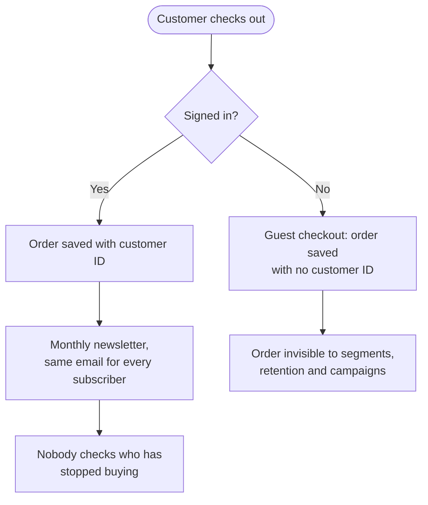
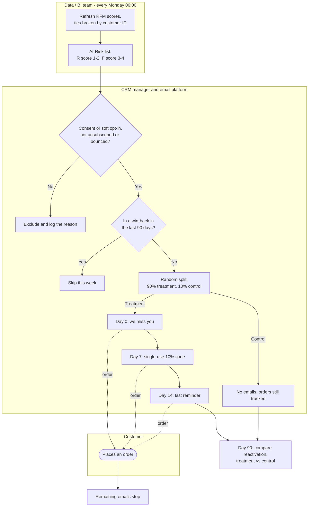
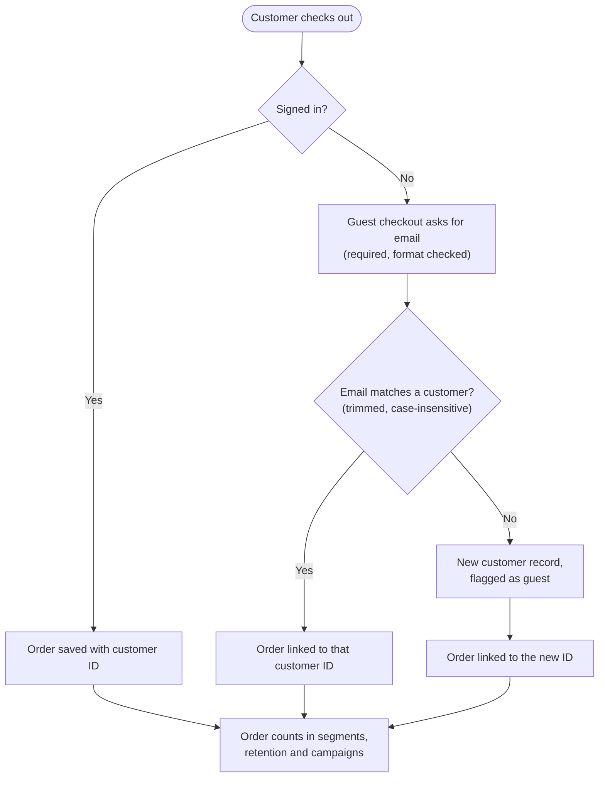

# 3. Process maps

The as-is flow is partly assumed (marked below) and would be confirmed with the CRM manager and the web team.
The diagrams are Mermaid and render on GitHub.

## 3.1 As-is: order capture and marketing

**Pain points**

| # | Pain point | Evidence | Fixed by |
|---|---|---|---|
| 1 | Orders without a customer ID can't be analysed or targeted | 235,151 rows, £2.94M (~14% of sales) | FR-10 to FR-12 |
| 2 | Lapsing customers are not noticed | 888 At-Risk customers, £2.19M, ~275 days since last order | FR-01, FR-04 |
| 3 | Marketing results can't be proven | No control group today *(assumed)* | FR-05, KPI-2, KPI-3 |
| 4 | Segments can change between two runs on the same data | Per-customer export: 895 At-Risk; summary: 888 | FR-02 |

## 3.2 To-be: weekly win-back

## 3.3 To-be: guest checkout links the order to a customer

## 3.4 What changes

| Step | As-is | To-be | Requirements |
|---|---|---|---|
| Spot lapsing customers | Not done | Weekly RFM refresh and At-Risk list | FR-01 to FR-03 |
| Choose who to email | Every subscriber gets the newsletter | At-Risk only, after consent and suppression checks | FR-04 |
| Measure the effect | Not possible | 10% random control group | FR-05, KPI-2, KPI-3 |
| Win-back contact | None | 3 emails over 14 days, stop on order | FR-06 to FR-09 |
| Guest checkout | Order saved with no customer | Email required and matched to a customer | FR-10 to FR-12 |
| Reporting | Monthly revenue only *(assumed)* | Weekly campaign dashboard, monthly data-capture trend | FR-13, FR-14 |
